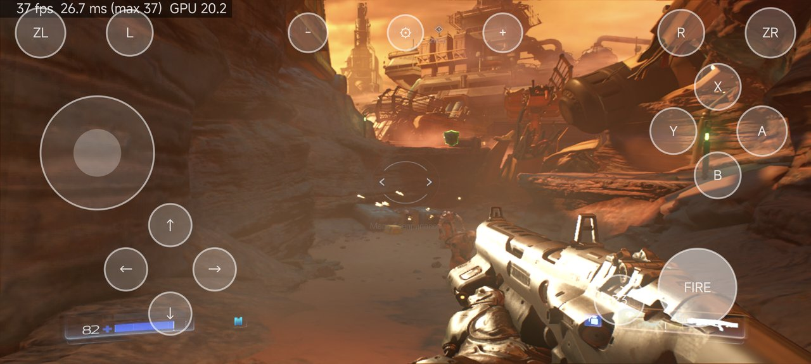
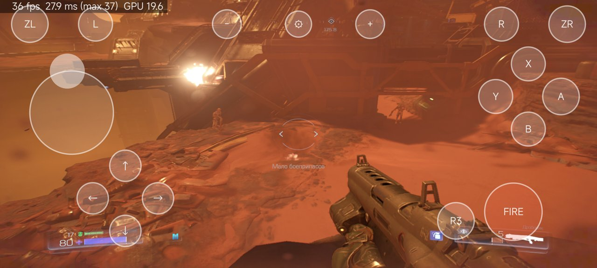
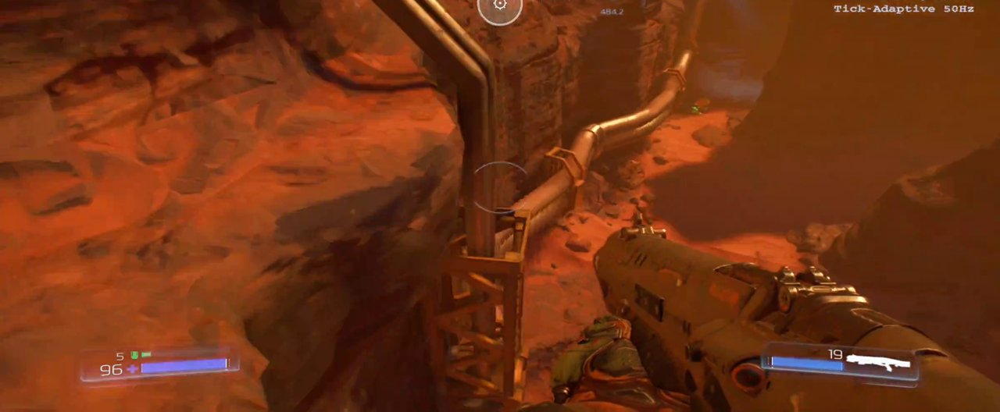
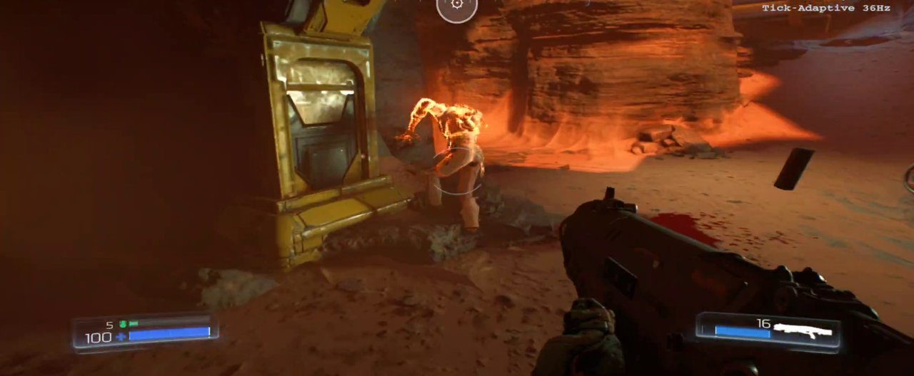
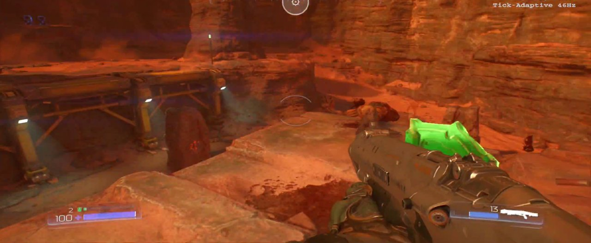
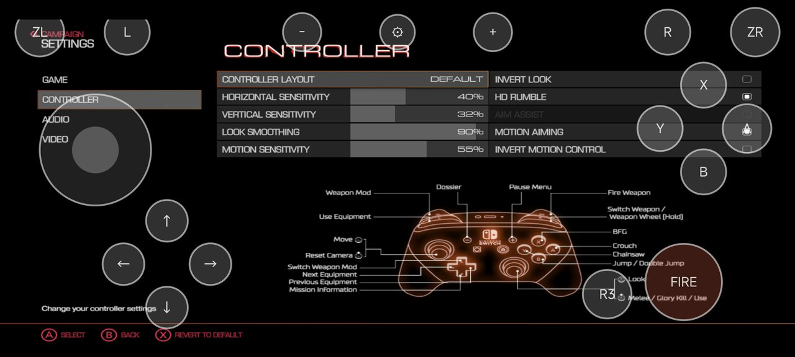
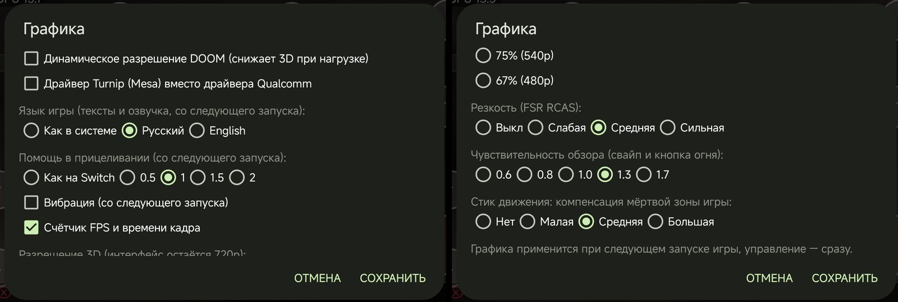

# DOOM Mobile

**A native Android port of DOOM (2016) for Nintendo Switch.** The game's own AArch64 program runs directly on the
phone's CPU; a small host provides the Switch system services, and the NVN graphics API is replayed on Vulkan.
You bring the game: this repository contains no game content.

Русский: [ниже](#по-русски).

> **Tested so far on Adreno 750 (Snapdragon 8 Gen 3, Xiaomi 14 Ultra) and Adreno 740 (Snapdragon 8 Gen 2).** Other GPUs
> are untested. Adreno 6xx/7xx use the bundled Mesa **Turnip** Vulkan driver by default; other Adreno generations get
> their Turnip package, and non-Adreno GPUs (Mali, PowerVR, Xclipse) use the phone's own driver, with engine fallbacks
> for features those GPUs lack (see *Vulkan drivers* and *Other GPUs*).

## Screenshots

Captured on the phone (Adreno 750, Qualcomm driver). The counter in the top-left corner is the port's own FPS / frame
time / GPU time overlay (it can be turned off in the settings). These shots predate the aspect-ratio fix: they show the
16:9 image stretched to the 20:9 screen; current builds render 1600×720 widescreen (or 16:9 with side bars).

**On-screen controls** (shown while no gamepad is connected):

| | |
|---|---|
|  |  |

**With a gamepad** (Bluetooth / USB): the on-screen controls hide themselves and come back when it disconnects.

| | |
|---|---|
|  |  |
|  |  |

## Port settings (gear button)

The gear at the top of the screen opens the port's own settings, on top of the game's menus:



| Setting | Default | What it does |
|---|---|---|
| Dynamic resolution | off | lets the game lower the 3D resolution under load; the same switch as **Video → Dynamic Resolution** in the game menu, applies at once and is saved in the game profile |
| Vulkan driver | by GPU | Adreno 6xx/7xx: bundled Turnip; other Adreno: their Turnip package; others: system driver. Or any package in `Download/DOOM Mobile/drivers` (next launch); a driver that fails falls back to the system one with a message |
| Frame rate limit | 60 | 30 / 60 / 90 / 120 (only rates your display supports; next launch; above 60 is experimental) |
| Game language | system | text and voice: system language, Russian or English (next launch) |
| Aim assist | 1 | strength of the game's aim assist; "Как на Switch" keeps the Switch behaviour (next launch) |
| Widescreen | on | 1600×720 (screen aspect, wider view) instead of 1280×720 16:9 with side bars (next launch; turn it off on weaker devices) |
| Rumble | off | controller / phone vibration (next launch; off to save battery) |
| FPS and frame time counter | on | the overlay in the top-left corner |
| 3D resolution | 100% (720p) | 85% / 75% / 67%; the HUD stays at 720p |
| Sharpening (FSR RCAS) | off | weak / medium / strong |
| Look sensitivity | 1.0 | swipe look and the look while FIRE is held |
| Move stick dead-zone compensation | none | offsets the game's own move-stick dead zone |

Each option says whether it applies at once or on the next launch. The dialog follows the system language: English,
Russian, Ukrainian, German, French, Spanish, Portuguese, Italian, Polish, Turkish, Simplified Chinese, Japanese, Korean.

## What it is, and what it is not

**It is:**

- The original game code, **executing natively** on the phone — no emulated CPU, no JIT. Switch and Android phones
  share the AArch64 instruction set; an offline rewriter changes only the few instructions that cannot run unchanged
  on Linux (x18 use, TLS reads, system calls, counter reads) into calls to the host.
- An HLE host for the Horizon OS services DOOM uses (threads, memory, file system, audio renderer, input, sockets…),
  and an NVN → Vulkan recorder and engine tuned for Adreno GPUs.
- A phone port: on-screen controls with mouse-like touch look, game controllers, gyro aiming, aim assist, rumble,
  resolution scaling and sharpening, the game's own languages (including Russian) following the phone's locale.

**It is not:**

- An emulator, cloud gaming or streaming.
- **A source of game content.** There is no game program, data, shader, text or key in this repository, and the APK
  contains none. You dump DOOM from a Switch you own and convert it on your PC ([docs/doom/GAME_FILES.md](docs/doom/GAME_FILES.md)).
  What the repository knows about the game (patch addresses, cvar names, shader identifiers…) is listed in
  [docs/doom/DERIVED.md](docs/doom/DERIVED.md).
- Online. The MULTIPLAYER entry is removed from the main menu and every network / account service answers like a
  console without a connection; the campaign runs fully offline.
- Affiliated with id Software, Bethesda, ZeniMax, Panic Button or Nintendo.

## Current state

Tested on **Snapdragon 8 Gen 3 / Adreno 750** (Xiaomi 14 Ultra) and **Snapdragon 8 Gen 2 / Adreno 740** (Xiaomi 13 Pro).
Other Snapdragon devices may work; other GPUs are untested.

- The campaign is playable from the main menu through gameplay. Output is **1600×720 widescreen** by default on a
  20:9 screen (same height as the Switch's handheld 720p, with a wider Hor+ view: more on the sides, nothing
  stretched); the original **1280×720 (16:9)** with side bars is optional in the settings and ~25% lighter on the GPU.
- Performance at 1600×720 with Turnip v27: **Snapdragon 8 Gen 3 (Adreno 750)** — 50–60 fps in most of the campaign
  (capped at 60), the heaviest areas ~35–50 fps; **Snapdragon 8 Gen 2 (Adreno 740)** — ~40–50 fps, heavy areas ~33–40 fps
  (measured on a warm, thermally throttled phone). Turning widescreen off (1280×720) or lowering the 3D resolution helps
  on 8 Gen 2 in pixel-heavy scenes (the heaviest areas are geometry-bound instead). Level loads use a fast NEON zlib.
  Optimisation is ongoing. The game's adaptive tick keeps game speed equal to real time at any frame rate.
- Memory: the game uses about 1.2–2 GB of RAM; its VRAM pools get extra headroom only on phones with 14 GB or more (half
  on 12 GB phones). On 8–12 GB phones close background apps before playing: when Android has to swap them out, level
  loads become much slower.
- Input: on-screen pad (left stick, mouse-like look on the right half, FIRE that also looks while held, R3),
  Bluetooth / USB controllers (the on-screen pad hides while one is connected), gyro aiming, aim assist with adjustable
  strength, rumble.
- Settings (gear button): widescreen, frame rate limit, 3D render resolution, dynamic resolution (shared with the game's
  Video menu), RCAS sharpening, Vulkan driver (by GPU, or your own package), game language, aim assist strength, rumble,
  frame counter, look sensitivity. The in-game Video menu's *Chromatic Aberration* entry is
  repurposed as *Dynamic Resolution*.

### Known issues

- The game's GPU triangle culling (`r_geometryCulling`, `r_smallTriangleCulling`) is **off by default**: on our GPU
  path it dropped visible triangles. Turning it on (`DM_DOOM_GEOMCULL=1`) is for debugging only.
- Dynamic resolution is off by default (it looked worse than a fixed lower resolution); enable it in the Video menu.
- Only update **v262144** is supported; the patches and addresses are tied to its build id.
- Turnip is the default driver and matches or beats the stock Qualcomm driver on Adreno 750; on other Adreno
  generations you may need another Turnip build (see *Vulkan drivers*); non-Adreno GPUs use the system driver.
- The heaviest scenes are still below 60 fps (see above).
- The port's settings dialog is in Russian for now.
- Many renderer fixes are still behind switches for A/B testing; see [docs/doom/SWITCHES.md](docs/doom/SWITCHES.md).

## Building

Requirements: Android SDK with NDK r29, CMake ≥ 3.22 and Ninja, JDK 17+ and Gradle, Python 3. Clone with submodules:

```sh
git clone --recursive <this repository>
# or, in an existing clone:
git submodule update --init --recursive
```

Configure and build the native host for DOOM (`DM_GAME=doom`; the default `d2r` builds the original D2R host):

```sh
cmake -S dm/android -B work/build-android -G Ninja \
  -DCMAKE_TOOLCHAIN_FILE=$ANDROID_NDK_HOME/build/cmake/android.toolchain.cmake \
  -DANDROID_ABI=arm64-v8a -DANDROID_PLATFORM=android-31 -DCMAKE_BUILD_TYPE=Release -DDM_GAME=doom
```

Then build, sign and (optionally) install the APK — `build.bat` on Windows (wraps the PowerShell script), `pwsh`
elsewhere:

```sh
build.bat [-Install <adb serial>]                 # Windows
pwsh tools/build_apk.ps1 [-Install <adb serial>]  # Linux / macOS with PowerShell
```

The script reads every tool path from the environment (`ANDROID_HOME`, `JAVA_HOME`, `GRADLE`, `PYTHON`) and signs with
`DM_KEYSTORE` (default: the Android debug keystore in `~/.android`). Output: `work/DOOM-port-debug.apk`, app id
`org.doom.port`. `work/` is git-ignored and holds every build output and every game-derived file.

## Installing

1. Dump your own copy (base game + update v262144) and your console's `prod.keys` — e.g. with nxdumptool and
   Lockpick_RCM on your Switch.
2. Prepare the game files with one command (it checks the inputs are the supported DOOM version, extracts ExeFS and
   RomFS, patches the code for Android and translates the shaders):

   ```sh
   ./setup.sh check                                                # what is missing; changes nothing
   ./setup.sh <base .nsp/.nsz/.xci> <update .nsp/.nsz> <prod.keys> [--push <adb serial>]
   ```

   On Windows: `setup.bat` with the same arguments. Needs Python 3, the **.NET 10 SDK** (shader translator) and ~70 GB
   of free space while unpacking NSZ. Details: [docs/doom/GAME_FILES.md](docs/doom/GAME_FILES.md).
3. Install the APK (from [Releases](https://github.com/Desm0nt/doom-port/releases/latest), or build it yourself, see
   *Building*) and copy `work/DOOM Mobile` to the phone's `Download` folder (or let `--push` / `./setup.sh push
   <serial>` do it over adb).
4. Start *DOOM Mobile* and allow *All files access* when asked.

## Vulkan drivers

The APK bundles **Mesa Turnip v27** (an adrenotools build of Mesa main for Adreno 6xx/7xx) and uses it by default; it
falls back to the phone's own driver when Turnip does not load or finds no supported GPU. On Adreno 750 Turnip v27 is
as fast as the Qualcomm driver or slightly faster.

**Automatic downloads.** When the phone is online, the app reads [`drivers/manifest.json`](drivers/manifest.json) from
this repository in the background and downloads the driver packages listed there that it does not have yet (Turnip
builds for other Adreno generations: A710/A720/A722, A8xx / Snapdragon 8 Elite, A740 on newer One UI firmware). Every
package is checked against the SHA-256 in the manifest. A package whose `auto` pattern matches the phone's GPU
(`/sys/class/kgsl/kgsl-3d0/gpu_model`, e.g. `Adreno720v1`) becomes the default from the next launch, unless you picked a
driver yourself. Offline nothing is downloaded and the bundled Turnip is used.

**Your own driver.** Copy an adrenotools driver package into `Download/DOOM Mobile/drivers/` on the phone, in either
form:

```text
Download/DOOM Mobile/drivers/
  my-turnip.zip              <- the package zip as released (meta.json + the driver .so), unpacked on the next launch
  my-turnip/                 <- or the unpacked folder
    meta.json
    libvulkan_freedreno.so
```

Restart the game, open the gear dialog, pick it under *Vulkan driver* and restart again. *System* selects the phone's
own driver. Compatible packages: adrenotools / Turnip releases such as
[Banners-Turnip](https://github.com/The412Banner/Banners-Turnip/releases) (use the plain Android builds, not the
`-Linux` / `-Wayland` ones). `TU_DEBUG` (Turnip's debug options, e.g. `sysmem`) can be set in
`Download/DOOM Mobile/dm/env`. To offer a driver to everyone, add an entry (name, url, sha256, optional `auto` regex)
to `drivers/manifest.json`.

## Other GPUs (Mali, PowerVR, Xclipse)

Untested on real hardware yet. These phones use their own Vulkan driver; the engine checks the device's features and,
instead of aborting, falls back where the game's Switch shaders need something the GPU lacks: no geometry shaders
(the game's culling shaders are skipped), no D24 depth (D32 is used), no format-less storage image writes, no
`shaderImageGatherExtended`, no GPU timestamps. BC textures are decoded on the CPU when the GPU cannot sample them.
Experimental third-party drivers exist and can be added as packages (see above): Mesa PanVK for Mali on stock kernels
(e.g. panvk-kbase-android) and RADV for Xclipse (radv-xclipse); there is none for PowerVR. Expect lower performance
than on Snapdragon 8 Gen 2/3. Reports (device, GPU, driver, log) are very welcome.

## Repository layout

| Path | What |
|---|---|
| `dm/` | The host (from d2r-mobile): loader, HLE (`dm/host`), NVN recorder and Vulkan engine (`dm/gfx`), Android app (`dm/android`), offline rewriter (`dm/tools/patch_nso.py`) and its verifiers (`dm/verify`). DOOM code is behind `DM_GAME_DOOM`. |
| `setup.sh`, `setup.bat`, `build.bat` | Game file preparation (`tools/setup_doom.py`) and APK build entry points |
| `tools/` | DOOM tooling: game file extraction, shader jobs, APK build, device test and analysis scripts |
| `third_party/libadrenotools` | git submodule (BSD-2-Clause) |
| `docs/doom/` | Port documentation: state, recon, switches, game files, derived information |
| `docs/research/` | Analysis notes behind individual fixes |
| `docs/upstream/` | d2r-mobile's original README and contribution guide; the other files in `docs/` are upstream's D2R documentation |

## Credits

DOOM Mobile stands on the work of others — thank you:

- **[d2r-mobile](https://github.com/jhaizhou-ops/d2r-mobile)** by jhaizhou (MIT) — the base of this port: native
  NSO loader and rewriter, HLE host, NVN → Vulkan engine, shader translation chain and Android app.
- **[nxnative](https://github.com/seedds/nxnative)** by seedds (MIT) — threads and SVCs, SDK 6.x services, audio
  renderer, NVN entry points, timestamp units, patcher and translator pieces.
- **[nx2android](https://github.com/shirai91/nx2android)** / nx2apk (MIT) — window acquire-sync fix (1c6177d),
  Android haptics, ADPF, gamepad code.
- **[BOTWRecompAndroid](https://github.com/mamcjr/BOTWRecompAndroid)** and
  **[LASRecompAndroid](https://github.com/mamcjr/LASRecompAndroid)** by mamcjr, and
  **[LASRecomp](https://github.com/peiikai/LASRecomp)** by Peiikai (MIT) — the Turnip / adrenotools driver loading
  approach, chunked submit and sync-lag ideas, UBWC / format-list and Turnip notes.
- **[libadrenotools](https://github.com/bylaws/libadrenotools)** by Billy Laws (BSD-2-Clause).
- **Ryujinx** shader translator (Ryujinx Team and Contributors, MIT), vendored by d2r-mobile in `dm/third_party/ryujinx`.
- **[AMD FidelityFX FSR 1](https://github.com/GPUOpen-Effects/FidelityFX-FSR)** RCAS (MIT).
- **[zlib-ng](https://github.com/zlib-ng/zlib-ng)** (zlib license) — optional fast inflate for the game's resource containers.
- **[Mesa](https://mesa3d.org) Turnip** (MIT) — the default Vulkan driver, bundled in the APK as the adrenotools build
  by **[The412Banner](https://github.com/The412Banner/Banners-Turnip)** (Mesa main). Not stored in this repository:
  `tools/fetch_turnip.py` downloads it at build time with a pinned SHA-256.
- Khronos **Vulkan validation layers** (Apache-2.0) — used for debugging, not redistributed.

Details per file: [docs/THIRD_PARTY.md](docs/THIRD_PARTY.md).

DOOM © id Software LLC, a ZeniMax Media company. DOOM, id, id Software and id Tech are trademarks of ZeniMax Media
Inc.; the Switch version was developed with Panic Button. Nintendo Switch and NVN are trademarks of Nintendo. This is an
unofficial, non-commercial fan project with no affiliation to any of them. Play it with a copy you own.

## License

MIT — see [LICENSE](LICENSE). The d2r-mobile copyright notice is kept; third-party components keep their own licenses.

---

## По-русски

**DOOM Mobile** — нативный порт DOOM (2016) для Nintendo Switch на Android. Оригинальный AArch64-код игры исполняется
прямо на процессоре телефона (без эмулятора и JIT); небольшой хост подменяет системные сервисы Switch, а графический API
NVN воспроизводится через Vulkan. Основа — проект [d2r-mobile](https://github.com/jhaizhou-ops/d2r-mobile) (MIT).

- **Игры в репозитории нет.** Нужна своя копия DOOM для Switch (база + обновление v262144) и свои ключи консоли;
  подготовка файлов описана в [docs/doom/GAME_FILES.md](docs/doom/GAME_FILES.md) (англ.).
- Проверено на Adreno 750 (Snapdragon 8 Gen 3, Xiaomi 14 Ultra) и Adreno 740 (Snapdragon 8 Gen 2); другие GPU не проверялись.
  Драйвер выбирается по GPU: Adreno 6xx/7xx — встроенный Turnip (Mesa), другие Adreno — свой пакет Turnip, Mali/PowerVR/Xclipse —
  системный драйвер с обходами в движке; если драйвер не запустился, игра переходит на системный и сообщает об этом. Производительность (1600×720): 45–60 fps на большей части кампании, в самых
  тяжёлых зонах ~35–50 fps на 8 Gen 3 и ~33–40 на 8 Gen 2 (замерено на прогретом, троттлящем телефоне); оптимизация
  продолжается. На телефонах с 8–12 ГБ памяти перед игрой лучше закрыть фоновые приложения: своп сильно замедляет загрузки.
- Вывод по умолчанию широкий **1600×720** (Hor+: шире обзор по бокам, без растяжения); классические **1280×720 (16:9)**
  с полосами — галочкой «Широкий экран» в настройках (со следующего запуска, на ~25 % легче для GPU).
- Экранный геймпад с обзором «как мышью», геймпады, гироскоп, aim assist, вибрация, русский язык (язык игры берётся из
  системы или задаётся в настройках), масштаб 3D-разрешения и резкость RCAS.
- Шестерёнка вверху экрана открывает настройки порта (на языке системы, 13 языков; у каждой опции указано, «сразу» или «со следующего
  запуска»): динамическое разрешение (тот же переключатель, что «Видео → Динамическое разрешение» в игре), лимит FPS 30/60/90/120,
  драйвер Vulkan, язык игры, сила
  помощи в прицеливании, вибрация (по умолчанию выключена), счётчик FPS, разрешение 3D, резкость RCAS,
  чувствительность обзора и компенсация мёртвой зоны стика (см. таблицу «Port settings» выше).
- Известные ограничения: GPU-куллинг треугольников игры выключен (на нашем пути он терял видимые треугольники),
  динамическое разрешение выключено по умолчанию, поддерживается только обновление v262144, мультиплеер убран, сетевые
  сервисы отвечают как у консоли без сети.
- Подготовка файлов игры одной командой: `./setup.sh <база> <обновление> <prod.keys> [--push <serial>]`
  (на Windows — `setup.bat`), проверка без изменений — `./setup.sh check`. Нужны Python 3, **.NET 10 SDK** и ~70 ГБ
  свободного места на время распаковки NSZ. Готовый APK — в [Releases](https://github.com/Desm0nt/doom-port/releases/latest).
- Сборка: `cmake -S dm/android -B work/build-android … -DDM_GAME=doom`, затем `build.bat` / `tools/build_apk.ps1` (см. «Building»).

Подробности о состоянии порта, переключателях и истории исправлений — в [docs/doom/](docs/doom/) и [docs/research/](docs/research/).
